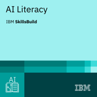
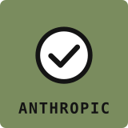

# Muhammadamin Nazirov

Full-stack engineer and founder of **TRACE**, a restaurant analytics and operations platform. Based in Tashkent, Uzbekistan. Self-taught: I learn by shipping production systems for real businesses.

[CV and contacts](https://my-businesscard.uz) · [TRACE](https://trace-os.uz) · [LinkedIn](https://www.linkedin.com/in/muhammadamin-nazirov-54432829a) · [Telegram](https://t.me/azamoviich)

## Featured projects

| Project | What it does |
|---|---|
| [**cartograph**](https://github.com/azamoviich/cartograph) | Point it at any GitHub repo and get an interactive dependency diagram, subsystem clusters and a risk map in under a minute. Import resolution verified at 0–0.7% unresolved on flask, fastapi, express and zod. |
| [**iiko-mac**](https://github.com/azamoviich/iiko-mac) | Runs iikoOffice and iikoChain on macOS with no virtual machine, using Wine and .NET Framework 4.8. One command to install. |
| [**api2mcp**](https://github.com/azamoviich/api2mcp) | Deterministic code generator: any OpenAPI spec becomes a working MCP server in one command. Published on PyPI. |
| [**sidequest**](https://github.com/azamoviich/sidequest) | Terminal games while your AI coding agent works; hands control back when the agent needs input. On npm as `sidequest-cli`. |

## TRACE

Multi-tenant SaaS for restaurants in Uzbekistan and the CIS, built solo: Node.js/Express and PostgreSQL backend, React web app, Expo mobile apps, a Tauri desktop app and and a native C# POS plugin that streams live orders over WebSocket. It is POS-agnostic: one adapter layer connects iiko, Poster and 1C. The source is private.

## Stack

TypeScript · JavaScript · Python · SQL · C# · React · Next.js · React Native · Node.js · Express · FastAPI · PostgreSQL · Docker · Claude API · MCP

## Certifications

<table>
  <tr>
    <td align="center" width="180">
       
      <b>AI Literacy</b> IBM SkillsBuild
    </td>
    <td align="center" width="180">
       
      <b>Claude Code in Action</b> Anthropic
    </td>
    <td align="center" width="180">
       
      <b>Manage Kubernetes in Google Cloud</b> Google Cloud skill badge
    </td>
  </tr>
</table>
